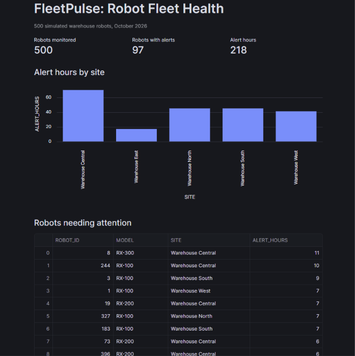
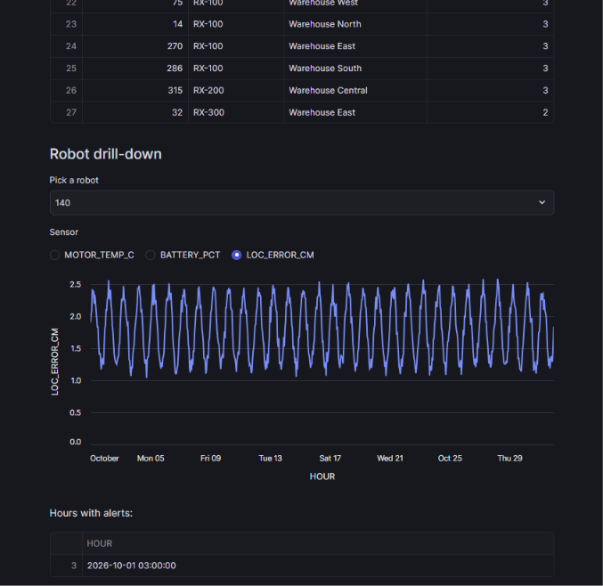
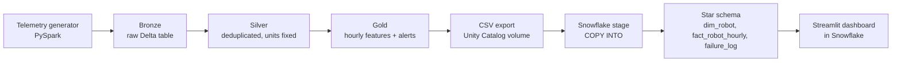

# FleetPulse

Robot fleet health monitoring pipeline built on **Databricks** and **Snowflake**. It processes 4.5M telemetry readings from 500 simulated warehouse robots, detects failing robots with per-robot anomaly detection, and serves the results through a Snowflake warehouse and a Streamlit dashboard.

## Results

Detection was scored against 40 injected failures that the pipeline never sees until evaluation.

| Metric | Result |
|---|---|
| Recall (failures caught) | **92%** (37 of 40) |
| Precision (alerts that were real) | **69%** |

| Failure type | Caught | Avg time to detect |
|---|---|---|
| Battery drop | 10 / 10 | ~2.2 hours |
| Localization drift | 12 / 12 | ~2.5 hours |
| Motor overheat | 15 / 18 | ~5.8 hours |

## Architecture

**Why both platforms:** Databricks handles the heavy transformation work on raw, messy data with Spark. Snowflake stores the clean, modeled results where they can be queried with SQL and served to a dashboard.

## Pipeline

**1. Data generation** (`databricks/01_generate_data`)
500 robots across 3 models and 5 warehouse sites, reporting battery, motor temperature, joint torque, localization error, and speed every 5 minutes for October 2026. Readings follow a daily work cycle with random noise. Three failure types are injected: gradual overheating, localization drift, and sudden battery drop. The data also includes realistic quality problems: duplicate rows, missing values, and one robot model reporting temperature in Fahrenheit.

**2. Silver: cleaning** (`databricks/02_silver`)
- Removed 44,231 duplicate readings, leaving exactly one row per robot per timestamp (4,464,000 rows)
- Converted the RX-300 model's Fahrenheit temperatures to Celsius
- Left missing values as null rather than inventing them, since downstream hourly averages skip nulls

**3. Gold: features and detection** (`databricks/03_gold`)
- Aggregated readings to hourly averages per robot (372,000 rows)
- Computed a rolling z-score for each sensor against that robot's own previous 7 days
- Raised an alert only when a robot was anomalous two hours in a row

**4. Snowflake** (`snowflake/setup_and_analytics.sql`)
Loaded the gold tables through an internal stage with `COPY INTO`, validated row counts, and modeled them as a star schema. Analytics queries rank robots needing attention, compare sites, and measure time to detection by failure type.

**5. Dashboard** (`dashboard/fleetpulse_dashboard.py`)
Streamlit in Snowflake: fleet KPIs, alerts by site, a ranked list of robots needing attention, and a per-robot sensor drill-down.

## Tuning the detector

| Version | Recall | Precision | Change |
|---|---|---|---|
| v1 | 90% | 21% | Single-hour z-score > 3 against last 24 hours |
| v2 | 80% | 56% | Require two anomalous hours in a row |
| v3 | **92%** | **69%** | Widen each robot's baseline from 24 hours to 7 days |

The first version flagged too many random noise spikes across 372K robot-hours. Requiring persistence filtered out one-off spikes but missed short failures. Widening the baseline gave a more stable estimate of each robot's normal behavior, which improved both metrics.

## Limitations and next steps

- **Slow drifts are detected late.** Overheating builds gradually, so each hour looks only slightly different from recent history. A rate-of-change or trend check would catch it earlier.
- **Detection has a built-in delay of about two hours** from hourly aggregation plus the persistence rule. Shorter windows would detect faster at the cost of more noise.
- **The data is simulated.** That is what makes measured recall and precision possible, but real telemetry would need validation against real maintenance records.
- **The Databricks to Snowflake handoff is a manual file export.** In production this would be an automated connector or scheduled job.

## Tech stack

Databricks (PySpark, Delta Lake, Unity Catalog) · Snowflake (SQL, internal stages, Streamlit in Snowflake) · Python

## Running it

1. Run the Databricks notebooks in order (`01` to `04`) in a Databricks workspace. Free Edition works.
2. Download the three exported CSVs from the `exports` volume.
3. In Snowflake, run the setup section of `snowflake/setup_and_analytics.sql`, upload the CSVs to `FLEETPULSE_STAGE`, then run the `COPY INTO` and analytics sections.
4. Create a Streamlit app in `FLEETPULSE.ANALYTICS` and paste in `dashboard/fleetpulse_dashboard.py`.
